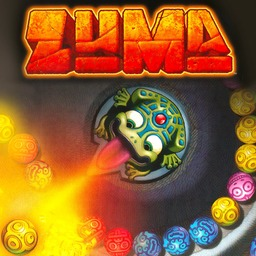

<h1 align=center>Zuma: Nintendo Switch port</h1>

<b>zuma-nx 1.0.2</b> · <a href="https://chanseyisthebest.github.io/zuma-nx-installer/">web installer</a> · <a href="https://github.com/ChanseyIsTheBest/zuma-nx/releases/tag/v1.0.2">release</a>

An unofficial native port of the Xbox 360 (Xbox Live Arcade) version of **Zuma** by PopCap Games and Oberon Media, with
touch controls. Made by static recompilation with [ReXGlue](https://github.com/rexglue/rexglue-sdk), from the
[Feeding Frenzy port](https://github.com/ChanseyIsTheBest/feedingfrenzy-nx)'s code. No emulator.

This repository contains no game files. You need your own copy of the game from your Xbox 360: the Xbox Live Arcade
content package (`584107EF`) and its **Title Update #2** (required).

## Playing it on the Switch

1. Open the web installer: **https://chanseyisthebest.github.io/zuma-nx-installer/**
2. Give it your game and its title update (their packages, or a folder that holds them) and press
   **Create zuma-nx.zip**. Your files never leave your computer.
3. Extract `zuma-nx.zip` into `sdmc:/switch/`.
4. Start it with a title override (hold **R** while starting an installed game) or a forwarder.

- Album applet mode does not give the game enough memory.
- A forwarder must be set to a **39-bit address space**.
- The first time you play, the game can stutter for a moment at the start while it compiles shaders. Later sessions
  start smoothly.

Features:

- Touch controls in handheld (`zuma_touch`): tap where the ball should go to turn and shoot, or touch and hold to aim
  and tap to shoot; tap with two fingers to swap the balls; tap the menus. The Options sliders move with the stick.
- The left stick aims and **A** shoots; face buttons work by position as on the Xbox 360 pad
  (`input_xbox_layout = false` for by letter); a single Joy-Con can be held sideways.
- Native deko3d renderer (Renut); 1280x720 in handheld and docked (the game's 640x480 picture scaled up in the
  middle, as on the Xbox 360), 60 fps.
- The console's system language by default, or `zuma_language`: `en`, `ja`, `de`, `fr`, `es`, `it`, `ko` or `zh`.
- Settings are in `zuma.toml` next to the NRO; delete it to get the defaults back.
- A game menu: hold **A + B + X + Y + L + R** together (**+** closes it) for the settings (language, button layout,
  Joy-Con, touch, and the menu's own buttons, colour, font and background), the achievements and each player's
  controls. It saves your choices in `zuma.toml`.
- A smaller install: the installer stores the game files compressed, with the sounds as Opus.
- No log files, except `logs/rex/rex_crash.log` after a crash.

Known issue:

- Xbox LIVE (leaderboards) is not available. The game has no multiplayer.

## Building

Needs Windows with LLVM clang 20 and the VS 2022 Build Tools (PC build); devkitA64, libnx and deko3d from
[devkitPro](https://devkitpro.org) (Switch build), with uam and SPIRV-Cross built for the PC
(`tools/deko3d_build_tools.sh`); Python; and your own copy of the game and its title update.

The steps (PC test build, NRO, game data) are in [docs/building.md](docs/building.md). More in
[docs/zuma-notes.md](docs/zuma-notes.md), [docs/optimising-functions.md](docs/optimising-functions.md),
[docs/hand-natives.md](docs/hand-natives.md) and the Feeding Frenzy port's
[docs/feedingfrenzy-notes.md](docs/feedingfrenzy-notes.md).

## Credits and license

- **PopCap Games and Oberon Media**: creators of Zuma and its Xbox Live Arcade version. This is an unofficial,
  fan-made port.
- **ChanseyIsTheBest**: this port and the ports it is made from (feedingfrenzy-nx, bejeweled3-nx, the Peggle ports).
- **[Tom Clay](https://github.com/rexglue/rexglue-sdk)**: the ReXGlue SDK, built on the work of the
  **[Xenia](https://xenia.jp)** team.
- **[StevensND](https://github.com/StevensND/nfsmw-nx)**: nfsmw-nx (the SDK's Switch layer and much of the method) and
  [nfsmw-nx-installer](https://github.com/StevensND/nfsmw-nx-installer), which the installer page is built on.
- **[masterspike52](https://github.com/masterspike52/reNut)**: reNut, the renderer (reused with its author's permission).
- **banjo-nx** (Banjo-Kazooie: Nuts & Bolts port): Renut's Switch port (plume's deko3d back end, the shader generator
  and its optimisations).
- **[renderbag](https://github.com/renderbag/plume)**: plume. **[fincs](https://github.com/devkitPro/uam)** and
  devkitPro: deko3d and uam.
- **[hedge-dev](https://github.com/hedge-dev/XenosRecomp)**: XenosRecomp.
- **[devkitPro](https://devkitpro.org)** and **[switchbrew](https://github.com/switchbrew/libnx)**: devkitA64 and libnx.
- The sibling ports, which share their fixes, and the libraries in [THIRD_PARTY_NOTICES.md](THIRD_PARTY_NOTICES.md).

GPL-3.0 (see [LICENSE](LICENSE)); the SDK keeps its BSD-3-Clause license (see
[THIRD_PARTY_NOTICES.md](THIRD_PARTY_NOTICES.md)).

No affiliation with PopCap Games, Oberon Media, Electronic Arts, Microsoft or Nintendo. "Zuma" is a trademark of
PopCap Games / Electronic Arts; the icon (`docs/icon.jpg`, also the NRO's icon) is the game's artwork, © PopCap Games.
Apart from that icon, this repository contains no assets or program code from the original game: you provide your own
legally obtained copy, and everything made from it is made on your own computer. Running homebrew requires custom
firmware, which violates Nintendo's ToS and can get a console banned.
